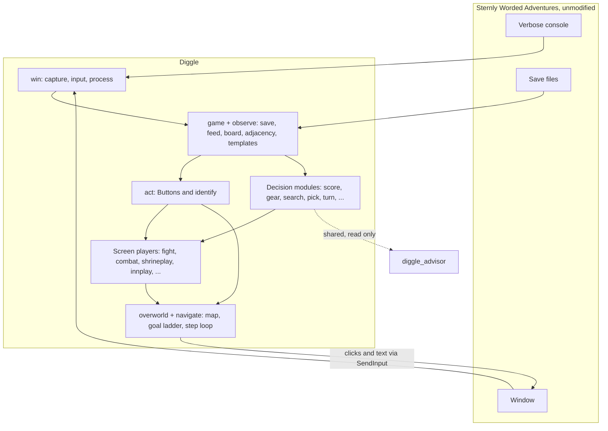

# Architecture

Diggle is an external Windows program. It never modifies the game. It reads the running game three
ways, plans with its own model of what it read, and acts by injecting real input.

## Seeing and acting

| Channel | Gives | Lives in |
|---|---|---|
| The game's verbose console | Events, the tile board each turn, overworld adjacency dumps, shop stock | `src/observe/`, `src/game/launch.rs` |
| The save files | Health, gear, the fight in progress, flags | `src/game/save.rs` |
| Screen captures | Which screen this is, which buttons are live, where tiles are | `src/win/capture.rs`, `src/act/`, `src/observe/template.rs` |
| Injected input | Mouse clicks, text for tile letters, arrow keys for hotspot navigation | `src/win/input.rs`, `src/win/nav.rs` |

No one channel is enough. The console announces events but not state, the save has state but is
written on screen exit, and the screen is the only source for "is this button live right now".
[observation.md](observation.md) covers how they are combined.

## Layers

From the bottom up. A layer uses the ones below it and never the reverse.

1. **`win`**: Win32. Capture, window, process enumeration, `SendInput`, cursor.
2. **`game` and `observe`**: parse what the game produced. The save reader, the console feed, board
   and adjacency parsers, template matching.
3. **`act`**: `Button`s and `identify`. A click is gated on matching the button's own face, so a
   layout change refuses to click instead of clicking the wrong thing.
4. **Decision modules**: functions of game data, with no console and no screen. `score`, `gear`,
   `lexica`, `spells`, `typist`, `search`, `pick`, `rested`, `flee`, `letters`, `turn`, `shrine`,
   `rest`.
5. **Screen players**: the acting halves, which know what to press on one kind of screen. `fight`,
   `combat`, `itemchoice`, `shrineplay`, `innplay`, `shopplay`, `heroselect`.
6. **`overworld` and `navigate`**: the map Diggle builds, the goal ladder, and the loop that looks at
   the screen, decides and acts.

The split between 4 and 5 is deliberate. Everything in 4 can be tested without the game, and the
Advisor reuses it.

## Binaries

| Binary | Role |
|---|---|
| `spike_run` | The driver. Launches the game and runs the navigator until it stops, writing a log and a report |
| `diggle` | A one-shot dev console: launch, capture, click, probe, solve offline |
| `diggle_advisor` | A window for playing yourself with Diggle's ranking beside you. Sends no input |
| `checkpoint` | Saves and restores the sandbox profile |
| `gen_*` | Generators for tables built from the game's data |
| other `spike_*` and `probe_*` | One-off measurement instruments. Each exists to answer a question about the game |

## Every action is checked on both sides

An action is never just a click. Before it, Diggle confirms the thing it is about to press is there.
After it, Diggle confirms the thing it expected actually happened.

**Before: confirm the target.** A coordinate is a promise about layout that nothing checks, so a click
is gated on matching the button's own face (`act::locate`, `act::click_when_ready`).

- `Restart` sits beside `Continue` and wipes the save, and `Hint` and `Fight on!` share a slot, so
  position can never identify a button. The label and artwork do.
- A layout change makes the match fail, and a failed match **refuses to click**. That is the failure
  we want.
- "Not there yet" and "not there" are different, and only waiting tells them apart. Callers wait for
  the button to appear instead of sleeping a fixed time first.
- A threshold is set against the nearest state the button could be mistaken for, never against
  background, and sits directly below the button it guards, with its measurement.

**After: confirm the result.** A click that was sent is not a click that worked.

- The expected outcome is checked on the channel that can see it. A tile selection is read off the
  tile (`combat.rs` confirms each tile before the next click). `Finish` is verified and retried
  (`fight.rs`). A transition is a console announcement since the `Feed` mark, a saved state, or a
  new screen.
- **A retry is bounded**, and the failure is reported with what was and wasn't confirmed. An
  unconfirmed state is never treated as success, and a half-selected board is cleared before the next
  attempt, or it would submit a different word than the one that was scored.
- Waiting for an outcome is a poll on that outcome, not a sleep. The waits that remain are named in
  `timing.rs`.

See [observation.md](observation.md) for the channels that make the second half possible.

## Rules every layer shares

- **Report and under-estimate.** Where the model is missing a piece, say so in the log and carry on
  with an estimate that errs low. Guessing is worse. A `not modelled` line is the design working.
  The exception is a goal with a ceiling (frightening an enemy off), where under-estimating damage
  is the wrong direction; see [combat.md](combat.md).
- **Ask what the screen is before acting on an assumption about it.**
- **Announcement is not readiness.** Wait for the thing itself, check the input took, and retry.
- **Every fixed wait has a name and a reason.** They live in `src/timing.rs`.
- **Cite the game.** A claim about the game points at the Lua that makes it true, or says it is
  inferred.
- **The answer is off limits.** A shrine's word is in the save and derivable from the seed. Reading
  it is cheating; the solver plays what it can see.
- **A guard needs a test that fails without it.**
