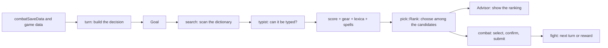

# Combat

One turn: decide a word, put it on the board, submit it. The decision is separate from the
actuation so that the Advisor can share it.

## The decision

`src/turn.rs` builds a turn's decision from `combatSaveData` and the game's data files alone: no
console and no screen. Diggle then types the word. The Advisor only shows it. One input stays on
Diggle's side, the murder backoff, because a console line feeds it (`fight.rs`).

## Scoring

`score.rs` reimplements the game's `words.score` instead of running the game's Lua, and reads the
game's data (letter materials, border scores, ligature bonuses) instead of restating it.

On top of the tile sum:

- **`gear/`** applies gear `wordBonus` modifiers. Only some are evaluated. A held flag it can't
  evaluate is **reported** through `Adjust::unknown`, never silently dropped. The unmodelled ones are
  tracked in #133, #134, #135 and #136.
- **`lexica.rs`** applies enemy lexicon bonuses and resists, which matter for correctness.
- **`spells.rs`** works out which spell a word would cast and how hard it would hit. Casting is a
  choice, taken when it beats the plain attack.

## Which word can be played

`typist.rs` simulates what the game does when a word is typed, because the game's text input is a
specific greedy consumer. It decides which tile each character takes, and so the tile state that is
scored and the corner count that scales it. A word is playable if typing it works, not if the board
holds its letters.

## Searching

`search.rs` has a `Goal` that says what the turn wants. Examples are killing, hitting as hard as
possible, and frightening an enemy off with damage inside a band. Only the first-kill goal is a race
between threads. Every other goal scans the whole dictionary, because which word wins then depends on
the ranking and not on thread timing.

## Ranking

When several words satisfy the goal, `pick::Rank` chooses. The order is the design: payouts first (a
wood-only kill with the gear for it), then holding back gold and wildcards, then driving hazard tiles
toward the bottom of the board, then what the board looks like afterwards (`letters.rs`). None of
these decides whether to kill, and none outranks killing.

`rested.rs` and `flee.rs` add two things a word can be worth beyond damage: healing from overkill
when well-rested, and ending a fight by making an enemy run.

## Actuation

`combat.rs` selects each tile and confirms it before issuing the next click. It costs about a second
per word and means a gap never opens, so there is nothing to undo. A word that can't be placed puts
the board back with `Backspace` until it reads empty, and the fight carries on.

`fight.rs` owns the turn loop, the reward, and the return to the overworld. The item screen is
`itemchoice.rs`, because it has seven call sites and only one is a fight.

## The Advisor

`diggle_advisor` and `src/advisor/` call the same decision code and show the ranking in a window.
They share scoring and ordering with Diggle by construction, not by copying. The Advisor sends no
input and captures nothing.
