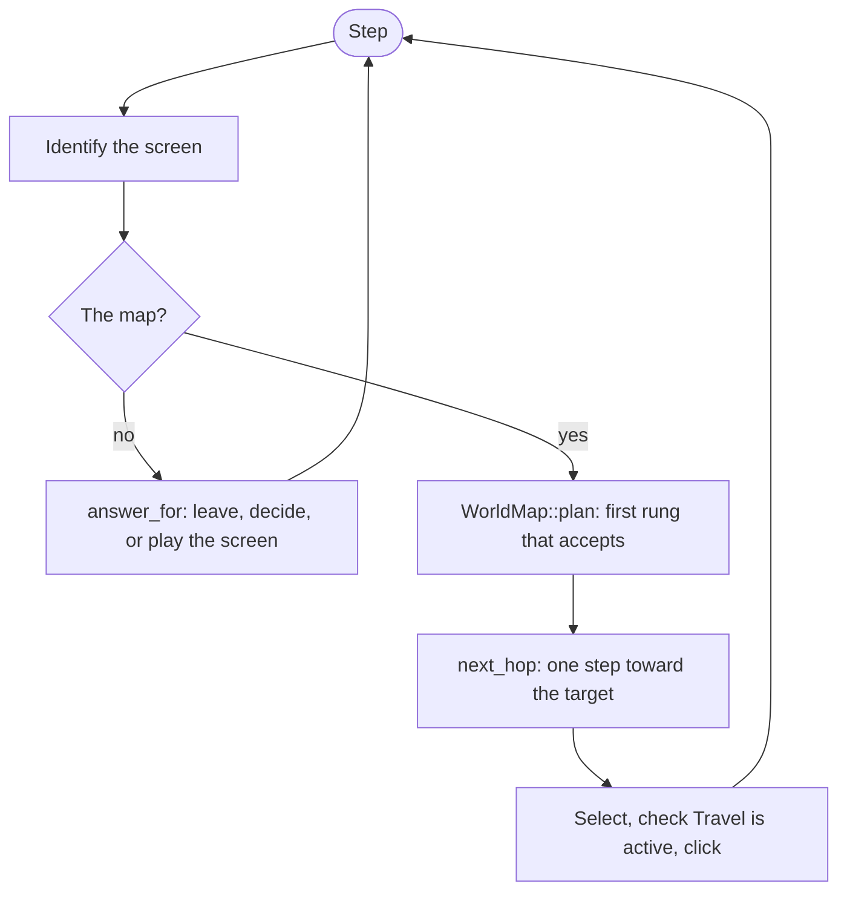
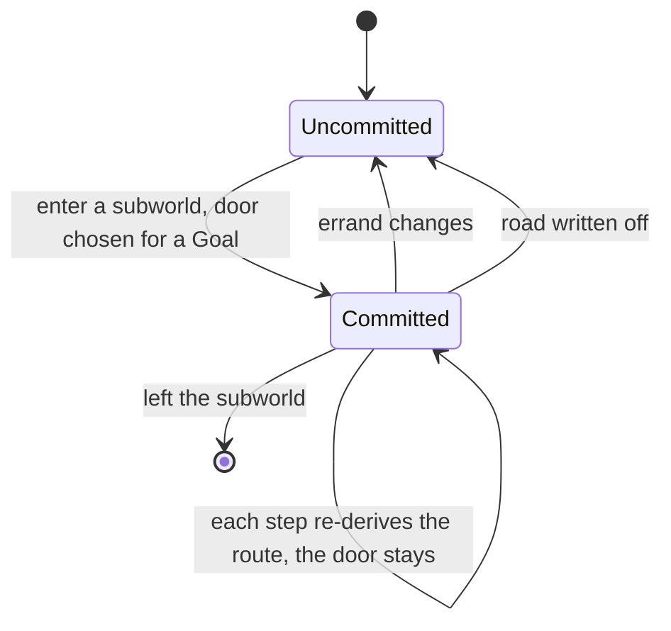

# Navigation

The navigator (`src/navigate/`) is the loop that decides what to do with whatever is on screen. The
overworld model (`src/overworld/`) decides where to go.

## One step

1. **Ask what screen this is**, before assuming anything about it.
2. **Answer whatever is not the map.** A dead end to leave, an event to decide, a fight to play.
   `ESCAPES` turns "press the button that leaves" into a table; `answer_for` covers every `Screen`.
3. **Only then plan a hop**, and take one.

`drive.rs` is the loop, `screens.rs` the screen vocabulary, `startup.rs` the once-per-profile path to
the overworld (cinematic, hero select, first shop).

## The map Diggle builds

Nothing hands over the world. The map is generated at runtime from the seed, so there is no graph on
disk. The only source is the adjacency dump: one hop, printed at certain moments. Folding the dumps
together as the run travels is how Diggle knows what exists (`overworld/mod.rs`).

- **A node with a hidden neighbour stays a frontier.** The count is kept and nothing else.
- **Pathfinding is the game's job.** Selecting a destination and reading whether `Travel` is active
  is the game's own breadth-first search. Diggle chooses where, not how.
- **A position is not an identity.** Keys identify; positions are aimable only under the view that
  produced them. `frame.rs` joins dumps into one frame, so a node the current dump doesn't name can
  still be aimed at.
- **`place.rs`** holds every question about a single node, with its justification from the Lua.

The map is cached per world seed in `map-cache/`, which is git-ignored and regenerated by walking.

## The goal ladder

`overworld/plan.rs`: `WorldMap::plan` is an ordered ladder of errands. Each rung declines for a
stated reason before the next is considered, so a run that ends up exploring has been refused by
every errand above it. The order is the design. The `Goal` a hop carries is a label for the log, not
a control switch.

Two survival conditions sit inside it: consecrations gate the anomaly rung, and a Well-Rested bank
gates a deliberate fight. Every gate has an escape at the foot of the ladder. A gate with no release
is a stall.

## Subworlds

`overworld/crossing.rs`. A village or forest interior is a fresh little graph that the fog reveals a
node at a time. Exits print their positions but not their keys, and the errand may be behind unseen
ground.

A crossing commits to its **destination door**, keyed by the `Goal` it serves, and re-derives the
route every step. It releases on a change of errand, on writing the road off, or on leaving the
subworld. Interior nodes are not linked to their container in the graph (#138), so the door can't be
ranked by distance from inside.

## What stops a loop

Only two things do: **explicit memory of what was already tried** (`Run::committed_to`,
`Run::shrines_tried`, `WorldMap::crossing_to`, `WorldMap::abandon`) and **a monotone progress
measure**. A ranking is neither. A stable preference between two alternating states is a cycle.

When adding a guard, state the condition that trips it and show that condition is reachable. A guard
that can never fire looks exactly like one that works; the [appendix](#appendix-the-loops-found-so-far)
has two. Open questions: #125 (the door ranking and the
router use different distances) and #126 (committing to one measurement).

## Errands that leave the map

`shrineplay.rs` and `shrine.rs` (consecration), `rest.rs` and `innplay.rs` (health), `shopplay.rs`
and `buyer.rs` (a shop is a pass-through, not a place to shop), `heroselect.rs` (refuses classes
there is no routing for), and `tower.rs` (a placeholder: it decides whether the tower's free map is on
offer and does not press it).

## Appendix: the loops found so far

The record behind "What stops a loop". Every one is the same shape: two nodes, each sending the run to
the other, forever. "Add cycle detection" was tried twice before this, and neither attempt fired.

| Cycle | Cause | What fixed it |
|---|---|---|
| A shrine and its neighbour | `next_target` excludes `here`, so arriving cancels the reason for arriving | `abandon` |
| A node and a used shrine | the planner routed to a used shrine that `drive` always declined | wiring `worth_consecrating_here` to a branch that acts |
| Two surface nodes | as the first | `Run::committed_to` |
| The wrong exit door | the explore fallback ignored the *other* exit roads | a filter in `cross_toward` |
| Two interior nodes | `retreats_running` counted **consecutive** retreats, a state that cannot occur | `Run::backed_out_of`, keyed by node |
| An interior node and the plaza | a comparison under a comment saying "unvisited first" actually preferred **visited** | fixing the inversion, then replacing the guess with a route to the nearest frontier |
| A door reversing mid-crossing | `exit_toward`'s ranking never applied inside a subworld, so the door was whichever exit the pan printed first | `WorldMap::crossing_to`, keyed by `Goal` |

Two of these were *failed* fixes, which is the more useful lesson.

- **`retreats_running` could never fire.** It tripped on two consecutive `Crossing::Retreat` verdicts.
  A retreat lands on a completed node, departure from a completed node is never blocked, so the next
  verdict is always a `Step`. The real cycle alternates retreat, step, retreat, step, and the `else`
  branch reset the counter every other turn.
- **"Unvisited first" was implemented as visited first.** An unvisited node scores `!seen == true`, a
  visited one `false`, and `false < true`, so walked ground won every comparison. The comment was
  right and the code was backwards.

Both survived review because each looked like the anti-cycling measure it was named after. Be
suspicious of a guard whose trigger condition nobody has shown to be reachable.

### Derived state and recorded state

Re-deriving a route every step does not cause cycles, and caching it would not cure them: three of
the first six cycles had a good route and cycled anyway. What helps is the distinction between two
kinds of state.

- A route is **derived**. It can be recomputed from the map at any moment, and caching it only adds
  staleness. The world moves under a cached route: fog lifts, corruption resets areas to incomplete,
  subworld layouts can re-roll on re-entry (`subworld::Rules::edges_survive_reentry`), and fights
  appear where there were none.
- "We already tried that" is **non-derivable**. No dump will ever say so, so it has to be remembered
  or it is lost.

So the rule is not more state. It is **state that records our own history, never state that mirrors
the game's**. Mirrored state has drifted from reality before: the sticky latest dump, the lore-screen
tally and the pregame counter.

Put another way, a policy has a value that strictly improves along its trajectory and cannot cycle.
A plan re-derived from a myopic objective cycles whenever the objective depends on position in a way
that flips the argmax. The first six cycles are one bug in that light: there is no potential function.
The seventh is the degenerate case, a ranking that turned out never to run.

