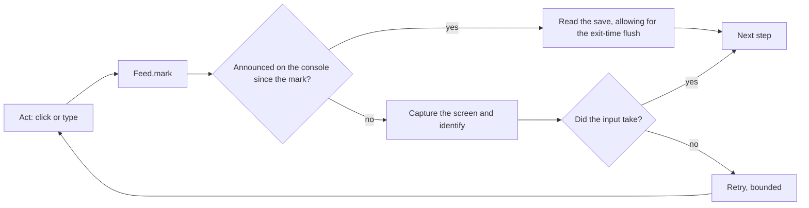

# Observation

How Diggle knows what the game is doing. Each channel has a failure mode that the others cover.

## The console

The game is launched with LÖVE's `--console` flag, so it reopens stdout onto a console Diggle owns
(`src/observe/log.rs`, `src/game/launch.rs`). Diggle reads that console's screen buffer.

What it carries:

- **The tile board** at the start of every player turn (`observe/board.rs`).
- **Overworld adjacency dumps** (`observe/adjacency.rs`): the current node, its visible neighbours,
  the subworld parent and exits. Node keys and screen positions come from here and nowhere else.
- **Arrival events** (`observe/event.rs`): title, prose and choices.
- **Shop stock and rest outcomes**, which are announced in full (`shopplay.rs`, `innplay.rs`).

`Feed` (`observe/feed.rs`) drains the console, mirrors it to disk for post-mortems, and answers "has
X appeared **since I acted**" with `mark` and `seen_since`. The question "has the reward screen
appeared" is almost never the right one, because the last fight's lines are still in the buffer.

The console reports events, not state. Returning to the map, for instance, announces nothing.

## The save

A save is a Lua source file returning a table literal, parsed by `game/save.rs`. It holds what the
console doesn't: health and gear, `combatSaveData` for the fight in progress, flags.

It is written when a screen exits, not when the action happens. A stale read just after an action is
expected, and is not a failure.

Two processes sharing one save directory overwrite each other, which is why `win/process.rs`
refuses to launch a second game. The solver drives the `LOVE` sandbox profile and never the real
Steam save. The Advisor is the one exception: it reads, and only reads, the real save.

## The screen

Captures are compared to templates cut from verified live frames. `act::identify` returns a
`Screen`, and the navigator's `answer_for` is exhaustive over it, so a new variant can't be added
without deciding what happens when the game shows it.

- **A button is a `Button`**: a template, a search rectangle, and a threshold set immediately below
  it with the measurement behind it. A threshold is set against the nearest state it could be
  mistaken for, never against bare background.
- **A click is gated on the match**, so the same pixel can be different buttons in different states
  without a wrong press.
- **Tile positions are derived**, not tabulated (`layout.rs`), because board shapes vary.
- **Positions in a dump are not identity.** They are screen coordinates under the current pan and
  zoom (`observe/pan.rs`, `observe/hud.rs`, `overworld/frame.rs`).

Calibration is at 1920x1080. Other sizes are refused; #64 and #65 track them.

## Combining them

The rule these serve is stated in [architecture.md](architecture.md#every-action-is-checked-on-both-sides).

- A transition is confirmed on the channel that can see it, then the input is checked and retried
  (`fight.rs`: `Finish` is clicked, verified and retried).
- A board isn't ready because `turnState` says `PlayerTurn`. Tiles may still be dropping, so
  `Board::wait_until_ready` waits for occupancy and stillness.
- A button's state is read off its artwork (`observe/affirm.rs`) when the console can't say.
- Waits are named in `timing.rs`, with what each one is waiting for.
